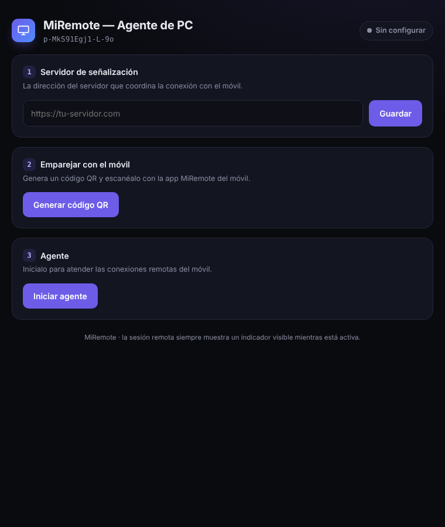
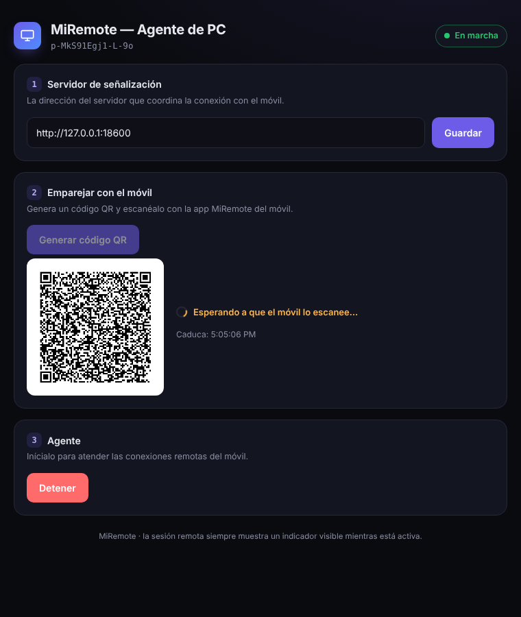
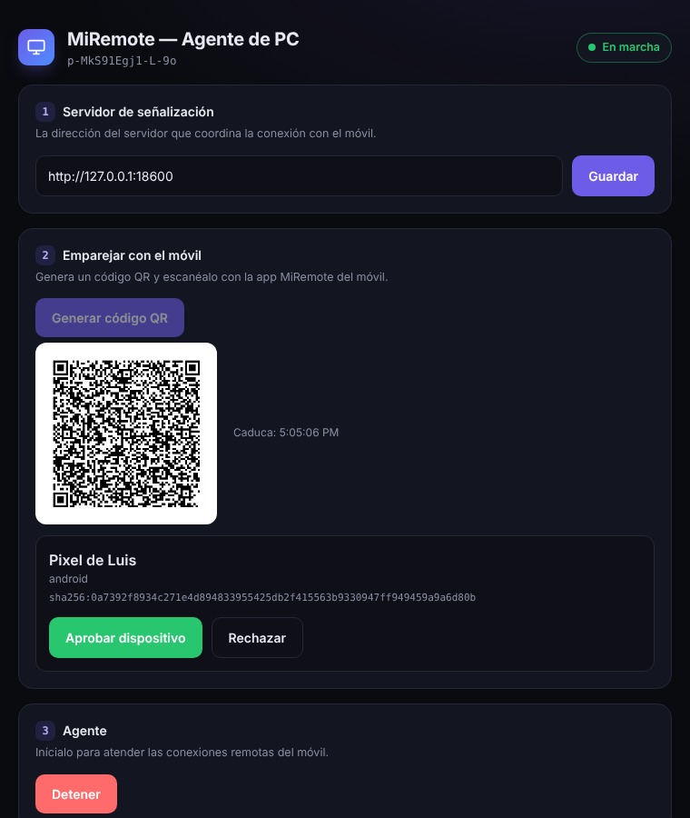
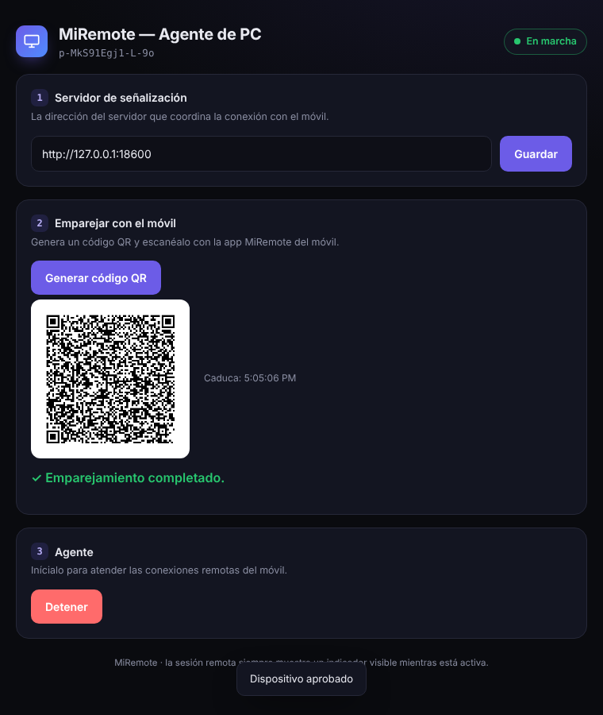
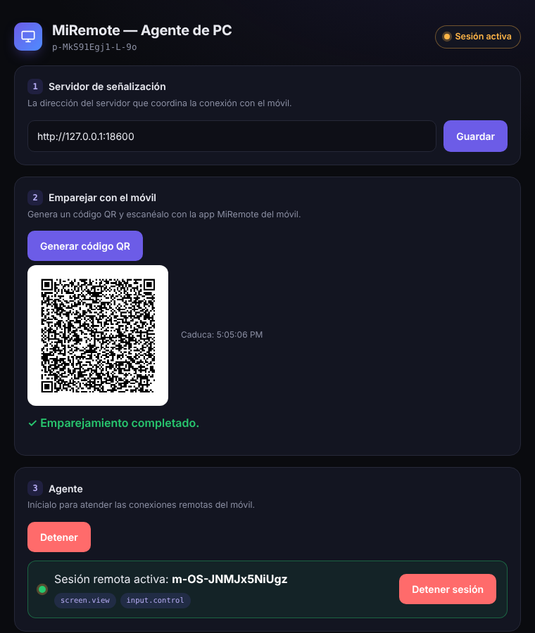
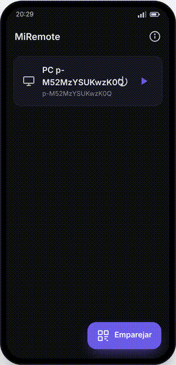
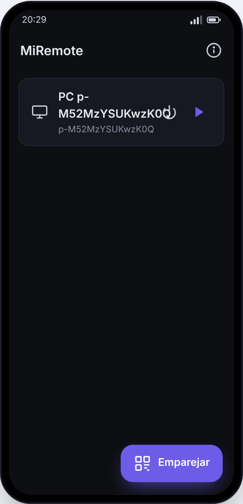
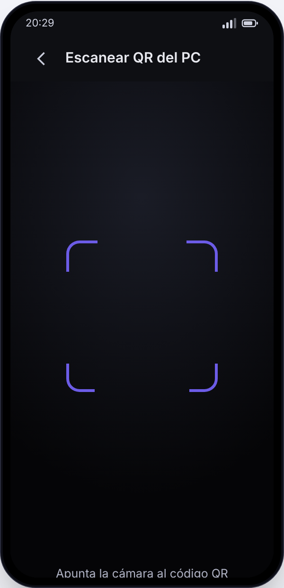
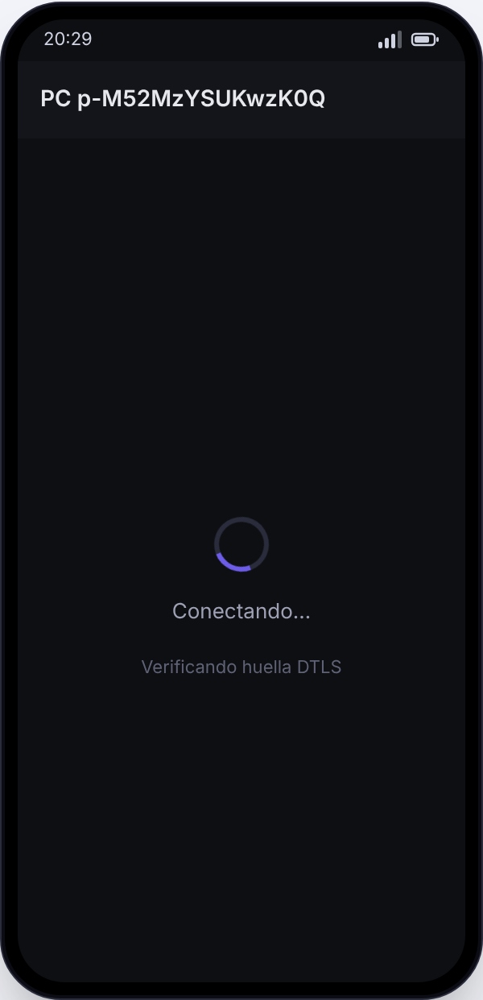
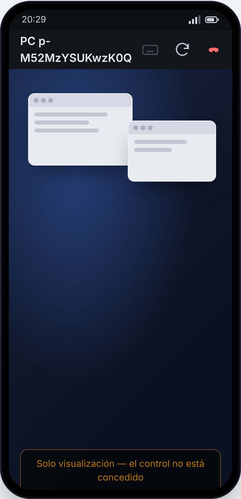

# Galería — MiRemote

Capturas y vídeos de la aplicación funcionando.

## PC (agente) — interfaz real verificada

El agente de PC abre su interfaz oscura en una ventana de app. Lo siguiente es
la interfaz **real** servida por el `.exe`, recorrida de principio a fin con una
sesión WebRTC en vivo (un móvil conectándose de verdad):

> Vídeo en mejor calidad: [`video/pc_demo.mp4`](video/pc_demo.mp4)

| Inicio | Emparejar (QR) | Reclamación |
|---|---|---|
|  |  |  |

| Aprobado | Sesión remota activa |
|---|---|
|  |  |

Cómo se generó: `flow_record` con Playwright contra el servidor real del agente,
señalización real y un cliente móvil WebRTC real (aiortc). El estado pasó por
`connected` y el panel mostró **Sesión remota activa**.

## Móvil (cliente Flutter)

Recorrido por las pantallas del cliente móvil:

> Vídeo: [`video/movil_preview.mp4`](video/movil_preview.mp4)

| Inicio | Escanear QR | Conectando | Pantalla remota |
|---|---|---|---|
|  |  |  |  |

> Estas pantallas del móvil reproducen fielmente la interfaz del código Flutter
> (`remote_mobile/lib/`). El APK se verificó además en un **emulador Android
> real** en CI: **instala y arranca correctamente** (`INSTALL Success`,
> `am start Status: ok`, sin crash). El flujo de captura automática de pantallas
> del emulador está en `.github/workflows/capture.yml` (sube la captura de
> inicio como artefacto descargable desde la pestaña *Actions*).

## Verificación — resumen

| Componente | Cómo se verificó | Estado |
|---|---|---|
| Señalización (Go) | Tests unitarios + e2e con binarios reales | ✅ |
| Agente de PC (Go) | Ejecutado bajo Windows (wine): menú, identidad, emparejamiento y conexión WebSocket; UI recorrida con sesión WebRTC en vivo | ✅ |
| Relevo WoL (Go) | Test del paquete mágico | ✅ |
| Cliente móvil (APK) | Compila; instala y arranca en emulador Android real (CI) | ✅ arranque |
| Captura de pantalla del PC | Esqueleto nativo DXGI+MF; pendiente de rematar en Windows con SDK | ⏳ |
